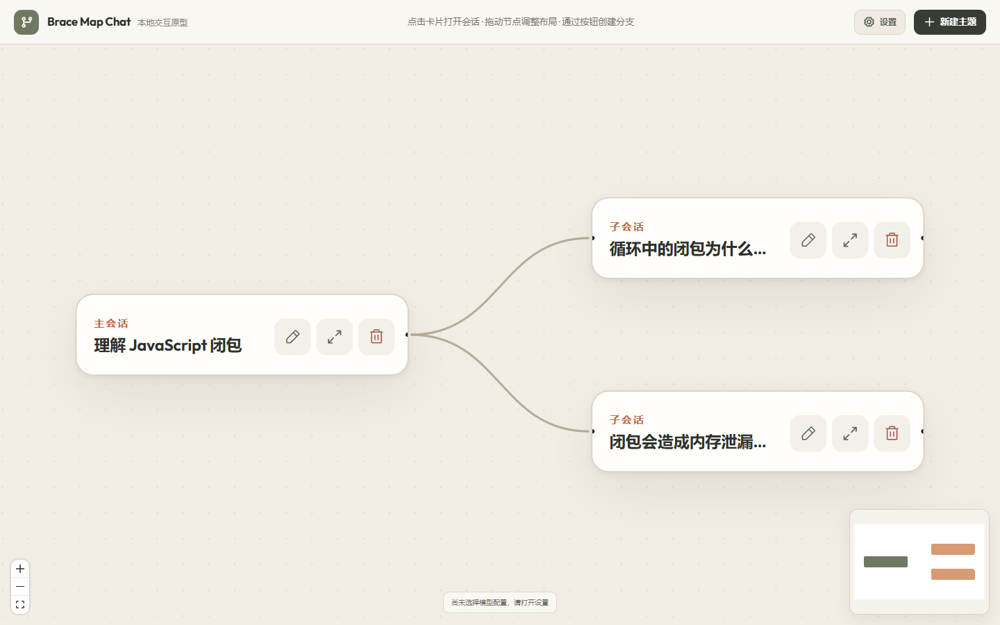

# Brace Map Chat

把学习会话组织成横向生长的 Brace Map。每个节点是一段独立的多轮会话，可以收起、展开、拖动和继续分叉。



## 本地运行

```bash
npm install
npm run dev
```

同一份项目一次只允许一个服务进程运行。即使第二次启动改用其他端口，也会立即退出，并在终端显示当前实例的访问地址、PID 和启动时间。同一服务也只允许一个浏览器页面取得编辑权；其他页面会停留在等待页，原页面关闭后自动接管，避免旧页面覆盖 SQLite 新数据。

生产构建：

```bash
npm run build
```

画布、节点、消息、笔记、布局、全局 Agent 会话与 Agent 规划会话保存在本地服务端 SQLite 数据库 `.data/brace-map-chat.sqlite`。浏览器不再是正式数据源；首次使用新版时，旧 `localStorage` 数据会在服务端确认写入成功后自动清除。模型请求仍通过同源服务端网关发送。

## 模型设置

点击右上角“设置”可以添加、编辑和删除多组模型，并将其中一个设为当前使用。每组模型包括名称、接口协议、服务地址、模型 ID 和 API Key。服务地址既可以填写根地址（自动补全协议路径），也可以填写完整接口地址；设置页可以从 OpenAI 兼容的 Models 地址实时拉取、筛选和选择模型 ID，也始终允许手动添加或编辑 ID。

当前支持以下上游协议：

| 接口协议 | 默认接口 |
| --- | --- |
| OpenAI Responses API | `POST https://api.openai.com/v1/responses` |
| Anthropic Messages API | `POST https://api.anthropic.com/v1/messages` |

普通节点会话调用 `POST /api/chat/stream`，服务端把不同上游的流事件统一为 NDJSON 增量；结构化任务仍使用 `POST /api/chat` 或 `POST /api/agent`。OpenAI 接入遵循[官方 Responses API 流式规范](https://developers.openai.com/api/docs/guides/streaming-responses)，Anthropic 接入遵循[官方 Messages API](https://platform.claude.com/docs/en/build-with-claude/working-with-messages)。请求地址可以修改，因此也可以连接实现相同协议的兼容服务。

模型配置保存在本机服务端的 `.data/model-profiles.json`。API Key 不写入浏览器 `localStorage`，配置列表接口也不会把密钥返回给浏览器；它只会告知对应配置是否已有密钥。`.data/` 已被 Git 忽略，请仍将它作为敏感文件保护，不要上传或分享。

## 学习数据备份

设置面板中的“学习数据备份”可以导出或导入一个带版本号的 JSON 文件。备份包含全部画布、节点、消息、摘要、笔记、全局 Agent 会话和 Agent 规划会话，但不包含模型配置、模型选择或 API Key。旧备份中的单份初始化草稿会在导入时自动转为规划会话。

导入前会完整校验文件格式、画布树、节点消息、学习摘要、Agent 审核操作和规划会话；任何一处无效都会拒绝整次导入，并保留当前数据。通过校验后仍需用户确认，画布、全局 Agent 会话和规划会话才会在一个 SQLite 事务中整体替换。

如需把服务端配置文件放到其他位置，可以复制配置模板：

```powershell
Copy-Item .env.example .env
```

并在 `.env` 中设置：

```dotenv
MODEL_CONFIG_PATH=D:/path/to/model-profiles.json
DATABASE_PATH=D:/path/to/brace-map-chat.sqlite
```

通常无需创建 `.env`，直接在设置面板中配置即可。不要把 `.env`、`.data` 或其他含密钥的文件提交到版本库，也不要在纯静态托管中暴露模型密钥。

## 会话与分支

- 一个画布对应一个完整学习主题；顶部可以切换、重命名、新建或删除画布。
- “新建画布”先选择“自主创建”或“Agent 初始化”：自主创建会建立一个带空白起始节点的独立主题；Agent 初始化通过对话生成总目标、3～7 个主要章节和必要的二级章节，不会向当前画布追加顶级节点。采用后总目标先进行整个主题的开场；章节在第一次展开且会话为空时再生成本章开场。
- 每次 Agent 初始化都是一条独立的“规划会话”，包括对话、未发送输入、当前结构和待确认调整方案。用户可以同时保留多条规划，新建、继续、重命名和删除；“新建画布”显示最近 3 条未完成规划，“查看全部规划会话”按更新时间列出未完成与已创建画布两组。规划被采用后仍保留为只读历史，并通过画布 ID 提供返回入口；自主创建画布不会删除任何规划。旧版单草稿会自动迁移且不丢失。主题与目标尚不明确时，Agent 会列出具体缺失信息；具备条件后显示“生成结构草稿”，且继续补充要求不会让按钮消失。生成结果已经包含划分依据，用户满意时可以直接采用；用户提出意见或手动编辑后，Agent 必须评价建议是否中肯并说明取舍，返回独立的待确认调整稿。只有用户点击“接受此调整”才替换原方案，也可以保留原方案或继续讨论。失败请求恢复到输入框，不写入规划上下文。
- 每个新画布默认只有一棵主树；当前画布的主节点删除后，可以在空状态中重新创建起始节点。
- 节点默认只显示可编辑标题，点击卡片或打开按钮后展开 `640 × 400px` 会话面板。
- 用户消息在右侧，AI 消息在左侧；多个会话可以同时展开、滚动阅读和独立拖动。
- 普通节点回复采用流式输出；生成期间发送按钮变为停止按钮。停止只取消当前节点，保留已经生成的正文并显示停止状态，不影响其他节点；连接意外中断和无正文失败会分别保留为“未完整”和“失败”消息。
- AI 消息按 Markdown 渲染，支持标题、强调、列表、引用、链接、表格、行内代码和代码块；代码块可以一键复制。
- 普通阅读时，浏览器原生选区只用于选择和复制，不会自动弹窗。
- 点击“摘录原文”后进入字符级拖拽模式：浏览器负责自然的文字拖选，应用在松手后保存范围；可以摘录单词、半句话、跨段或跨消息内容，反向拖动仍按正常阅读顺序保存，多次拖动可以组合不连续原文。
- 创建分支分为“背景摘要 → 引用原文 → 用户疑问”三步；背景摘要始终根据父节点完整会话生成，不能因内容出现次数少而忽略有意义的信息，生成后仍可编辑或完全手写。
- 节点“摘要”页可以由用户手动授权 Agent 通读完整节点会话并更新结构化学习摘要，之后仍可逐项编辑；系统不会按轮次自动总结。
- 创建子节点时会立即发送用户疑问；冻结的三段上下文会持续注入该子节点后续的独立多轮会话。一个节点可以创建任意多个子节点。
- 每条用户消息和 AI 消息都可以独立编辑或删除，修改结果会成为后续提问的真实上下文。
- “清空会话”只删除当前节点的消息，保留节点、标题、引用和笔记。
- “删除节点”会删除该节点；如果节点有后代，确认后会连同整棵子树一起删除。

服务端同时提供 `GET /api/health` 和 `GET /api/ready`。

## 全局学习树 Agent

全局只有一个 Agent，画布只是它当前查看的工作区。普通节点仍是隔离的会话窗口，不是 Agent，也不能读取其他节点。

Agent 每次先读取整棵树的结构化目录；信息不足时，它可以在单次固定循环中逐个请求节点完整会话。每一步只能选择“读取一个节点”“提交修改等待审核”或“结束”，一轮最多 4 步。树修改仍需用户逐项确认，审核完成后 Agent 会基于最新画布核对结果。

- `/model`：切换全局 Agent 使用的配置或模型；
- `/resume`：新建、恢复和删除当前画布下的 Agent 会话；
- `/inspect`：选择一个节点，由全局 Agent 读取其完整会话并检查是否出现值得独立学习的新方向；分支建议会绑定真实消息，接受后把必要背景、原文和问题冻结到新节点。

Agent 会话和审核卡保存在 SQLite；单次运行中的节点读取结果和步骤号不会持久化。刷新中断后，可以从 `/resume` 恢复会话并从最新树状态重新执行。

## 检查

```bash
npm run lint
npm test
npm run build
```

首次运行浏览器端到端测试前安装 Chromium：

```bash
npx playwright install chromium
npm run test:e2e
```

E2E 测试使用隔离数据库和显式测试实例开关，并通过页面级模型接口模拟，不读取或消耗已保存的 API Key。

## 文档

- [简历项目介绍](docs/resume-project.md)
- [当前产品说明](docs/product-spec.md)
- [全局学习树 Agent 设计](docs/agent-design.md)
- [SQLite 数据库设计](docs/database-design.md)
- [子会话上下文摘要备选设计](docs/context-summary-options.md)
- [子会话上下文交互说明与 Demo](docs/context-branch-demo.md)（该交互已合并到主画布；实验页仍可通过 `/context-demo.html` 访问）
